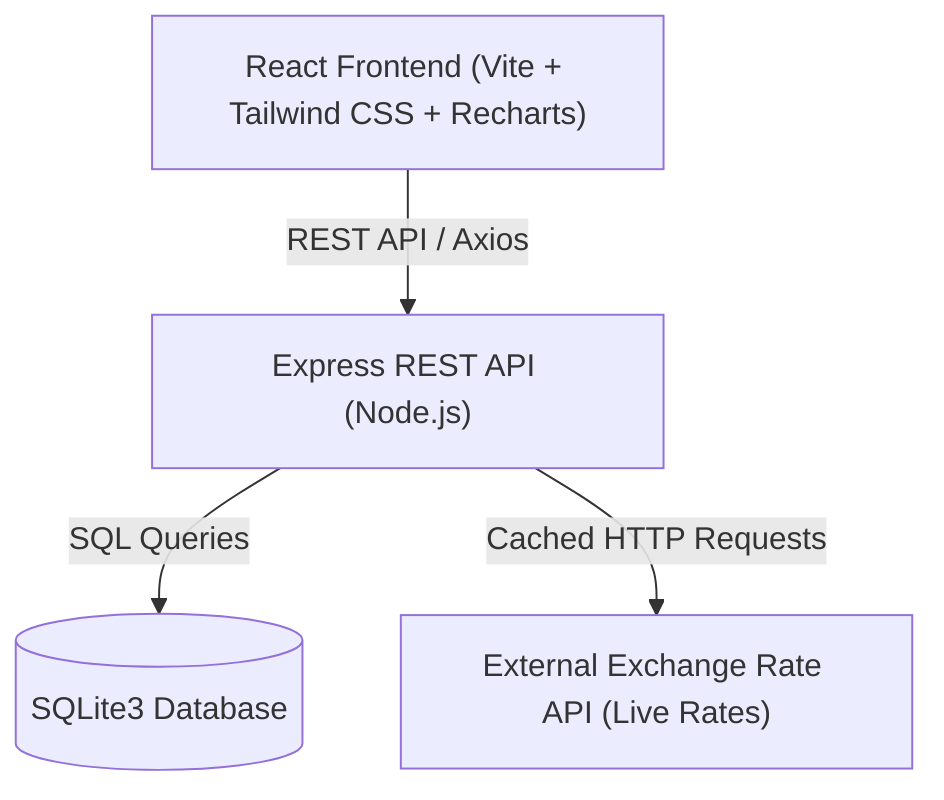

# 💰 SpendWise — Full-Stack Expense Tracker & Financial Analytics Platform

> A production-grade, end-to-end full-stack web application designed for personal finance management, visual data analytics, category budgeting, and real-time multi-currency conversion.

---

## 🌟 Highlights & Key Features

- **📊 Comprehensive Financial Analytics**:
  - Net balance, total income, total expenses, and savings rate KPI cards with month-over-month comparisons.
  - Multi-month income vs. expense cash flow trends visualized with **Recharts** (switchable Bar and Area chart views).
  - Category spending breakdown with an interactive Donut chart, percentage allocations, and custom legends.
- **💱 Real-Time Global Currency Intelligence**:
  - Live exchange rates integrated with external exchange rate APIs (`open.er-api.com`).
  - **In-memory server caching layer** (1-hour TTL) with offline fallback data to guarantee sub-millisecond responses.
  - **Global Currency Switcher**: Dynamically recalculates the entire dashboard into **USD ($)**, **EUR (€)**, **GBP (£)**, **INR (₹)**, **CAD (CA$)**, **AUD (AU$)**, or **JPY (¥)**.
  - **Interactive Currency Converter Widget**: Dedicated instant calculator to convert amounts between any two world currencies.
- **🎯 Category Budget Tracking & Alerts**:
  - Set and adjust monthly spending limits per category.
  - Visual color-coded progress indicators:
    - 🟢 **Safe** (< 80% of limit)
    - 🟡 **Warning** (80% - 100% of limit)
    - 🔴 **Exceeded** (> 100% of limit) with instant visual alerts.
  - Quick inline budget editor for quick budget modifications.
- **⚡ Transaction Management (CRUD)**:
  - Add, edit, delete, and view transactions with amount, type (expense/income), category, date, payment method, and description notes.
  - Live keyword search across notes and categories.
  - Multi-level filtering by transaction type, category, and date period.
- **📥 CSV Data Export**:
  - 1-click export of transactions into spreadsheet-ready `.csv` format (`/api/export/csv`).
- **✨ 1-Click Demo Data Generator**:
  - Pre-seeded realistic transactions spanning multiple months so interviewers and recruiters can immediately view charts and analytics without manual data entry.

---

## 🏗️ System Architecture & Tech Stack



| Layer | Technologies Used |
|---|---|
| **Frontend** | React 18, Vite, Tailwind CSS, Recharts, Lucide Icons, Axios |
| **Backend** | Node.js, Express.js, CORS, Dotenv |
| **Database** | SQLite3 (zero-configuration, self-contained relational database) |
| **Integrations**| Open Exchange Rates API with memory cache & fallback |

---

## 📁 Project Directory Structure

```text
expense-tracker/
├── package.json               # Root scripts for running full application
├── README.md                  # Comprehensive project documentation
├── server/                    # Backend REST API
│   ├── package.json           # Backend dependencies (express, sqlite3, etc.)
│   ├── database.sqlite        # SQLite database file
│   └── src/
│       ├── server.js          # Express server entry point & middleware
│       ├── routes/
│       │   └── api.js         # API route handlers
│       ├── controllers/
│       │   ├── transactionController.js  # CRUD & CSV export logic
│       │   └── analyticsController.js    # Metric aggregations & trends
│       ├── services/
│       │   └── currencyService.js        # Live exchange rates & caching
│       └── db/
│           ├── database.js    # Schema creation & connection helpers
│           └── seed.js        # Realistic demo transaction seeder
└── client/                    # Frontend React Single Page App
    ├── package.json           # Frontend dependencies
    ├── vite.config.js         # Vite configuration with proxy to port 5000
    ├── tailwind.config.js     # Tailwind CSS theme configuration
    ├── index.html             # HTML template
    └── src/
        ├── main.jsx           # React DOM root entry
        ├── App.jsx            # Main dashboard container & state sync
        ├── index.css          # Tailwind base & custom scrollbar styles
        ├── context/
        │   └── CurrencyContext.jsx       # Global currency & rate conversion provider
        ├── services/
        │   └── api.js         # Axios API service client
        └── components/
            ├── Navbar.jsx               # Header with currency selector & export
            ├── SummaryCards.jsx         # Financial KPI overview cards
            ├── ChartsSection.jsx        # Recharts monthly trends & donut chart
            ├── BudgetProgress.jsx       # Category budgets & alert indicators
            ├── CurrencyConverter.jsx    # Real-time exchange rate calculator
            ├── TransactionList.jsx      # Filterable & searchable transaction table
            └── TransactionModal.jsx     # Add / Edit transaction dialog
```

---

## 🚀 Quick Start Guide

### Prerequisites
- **Node.js** (v18+ or v22+)
- **npm** (v9+)

### 1. Clone or Open the Repository
```bash
cd expense-tracker
```

### 2. Install Dependencies
```bash
npm run install:all
```

### 3. Run the Application

```bash
npm start
```

This starts both the Express API at `http://localhost:5000` and the Vite frontend at **[http://localhost:5173](http://localhost:5173)**. Press `Ctrl+C` to stop both.

## Internship Report

- `INTERNSHIP_REPORT.md` is the editable report source.
- `INTERNSHIP_REPORT.html` is the print-ready browser version.
- `SpendWise_Internship_Report_Abinaya_R.docx` is the generated Word document. Regenerate it with `python make_docx.py`.

---

## 📡 REST API Reference

| Method | Endpoint | Description |
|---|---|---|
| `GET` | `/api/health` | Service health status check |
| `GET` | `/api/transactions` | Query transactions (supports `search`, `category`, `type`, `startDate`, `endDate`, `limit`, `offset`) |
| `POST` | `/api/transactions` | Create a new transaction |
| `PUT` | `/api/transactions/:id` | Update an existing transaction |
| `DELETE` | `/api/transactions/:id` | Delete a transaction |
| `GET` | `/api/export/csv` | Download transactions in CSV format |
| `GET` | `/api/analytics/summary` | Get KPIs (`totalIncome`, `totalExpenses`, `netSavings`, `savingsRate`, previous month comparison) |
| `GET` | `/api/analytics/monthly-trend` | Multi-month aggregated income vs. expenses data |
| `GET` | `/api/analytics/category-breakdown` | Expenses grouped by category with percentages |
| `GET` | `/api/analytics/budget-comparison` | Category budgets vs. actual spending with alert flags |
| `GET` | `/api/budgets` | List all category budget limits |
| `POST` | `/api/budgets` | Set or update a monthly category budget limit |
| `GET` | `/api/currencies/rates` | Fetch supported currencies and live exchange rates |
| `POST` | `/api/currencies/convert` | Calculate currency conversion between two currencies |
| `POST` | `/api/seed` | Seed realistic multi-month sample transactions |

---

## 💡 Key Design Decisions & Highlights for Internship Evaluation

1. **Clean Architectural Separation**: Dedicated separation between frontend (`client/`) and backend (`server/`), following the MVC/controller-service pattern for maintainability and scalability.
2. **Zero-Configuration Relational Storage**: Using SQLite with an automated schema initializer ensures anyone reviewing this project can clone and run it instantly without running a separate database server.
3. **Resilient Third-Party API Integration**: External currency exchange rates are cached in-memory with a 1-hour expiration policy and supported by hardcoded fallback rates to prevent downtime or rate-limit issues.
4. **Data Aggregations Done in SQL**: All monthly trends and category breakdowns leverage performant SQL `SUM()`, `GROUP BY`, and `strftime` operations rather than unindexed client-side loops.
5. **Polished Modern UI**: Built with dark mode aesthetics, micro-interactions, responsive grids, and accessible components.
